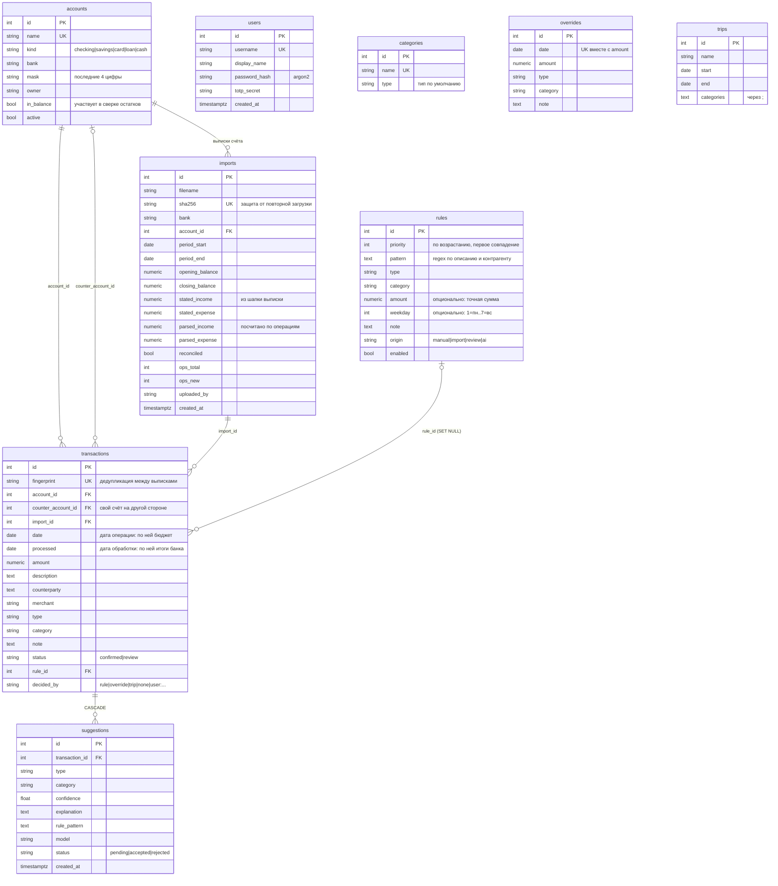

# База данных

PostgreSQL 17 (в кластере — CloudNativePG `family-budget-db`, база `budget`; локально — `docker compose`).
Модели — `backend/app/models.py`, миграции — Alembic в `backend/migrations/versions/`
(применяются init-контейнером `migrate` перед стартом приложения). Тесты гоняются на SQLite.

Суммы — `NUMERIC(14,2)`, рубли, со знаком: минус — деньги ушли со счёта, плюс — пришли.

## Схема

## Типы операций (`transactions.type`)

| Тип | Смысл | В отчётах |
|---|---|---|
| `expense` | трата | расход категории |
| `refund` | возврат (трата с плюсом) | уменьшает расход своей категории |
| `income` | доход, кэшбэк | доход |
| `savings` | на накопительный счёт / обратно | строка «Отложили», не расход |
| `internal` | между своими счетами, переводы жене | исключаются (жене — отдельной строкой) |
| `capital` | разовые крупные события (сделка с недвижимостью) | отдельная строка «разовые» |
| `?` | не определено | очередь разбора (`status = review`) |

## Как операция получает категорию

1. **Импорт** (`services/importer.py`): парсер выписки → строки с `fingerprint`. Уже известные отпечатки пропускаются, поэтому пересекающиеся периоды не дублируются. Итоги сверяются с шапкой (`imports.reconciled`).
2. **Правила** (`categorize/engine.py`): первое совпадение по `priority`. Затем поправки знака (трата с плюсом → `refund`, «Переводы людям» с плюсом → «Переводы от людей»), затем `overrides` по (дата, сумма), затем `trips`: покупки указанных категорий вне домашнего города (`BUDGET_HOME_CITY_REGEX`) в даты поездки → «Поездки».
3. **Ничего не подошло** → `type = ?`, `status = review`. ИИ может создать `suggestions`, но применяются они только по решению человека.
4. **Решение человека** (веб или `budget set`) → `decided_by = user:…`. Повторный прогон правил (`rules/apply`, `budget trip add/rm`) такие операции не трогает.

Бюджетный период начинается с `BUDGET_START_DATE` (по умолчанию 01.06.2026): операции раньше хранятся, но в отчёты не идут.

## Где что лежит

- Личные данные (операции, имена контрагентов, правила с именами) — только в БД. В репозитории их нет, тесты — на синтетической выписке `backend/tests/fixtures/`.
- Пароли — argon2. `totp_secret` хранится как есть: БД доступна только внутри кластера.
- Бэкапы: CronJob `pg_dump` → restic → S3 (`deploy/helm/family-budget/templates/backup.yaml`), включается `backup.enabled`. Сейчас выключено, см. `docs/operations.md`.
